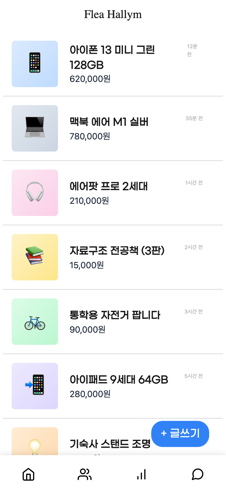
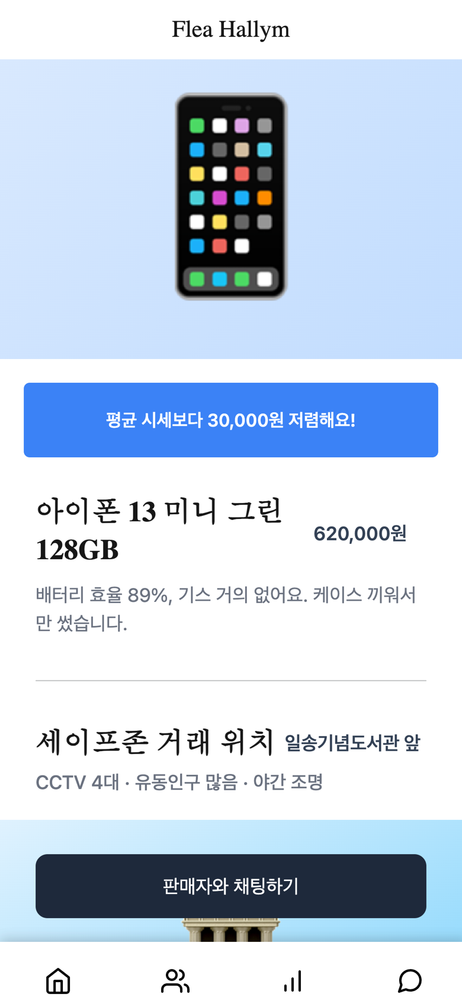
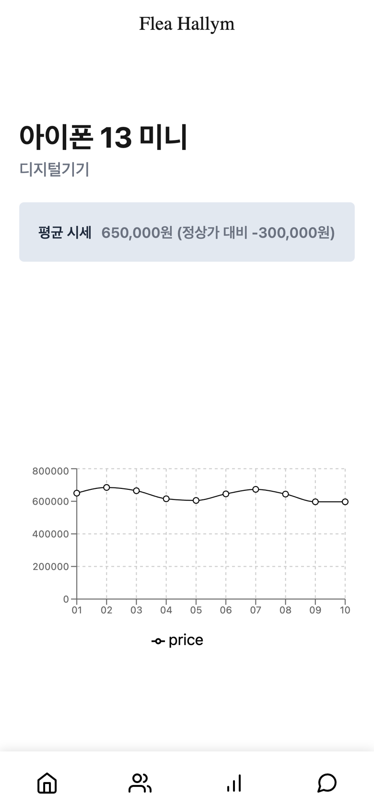
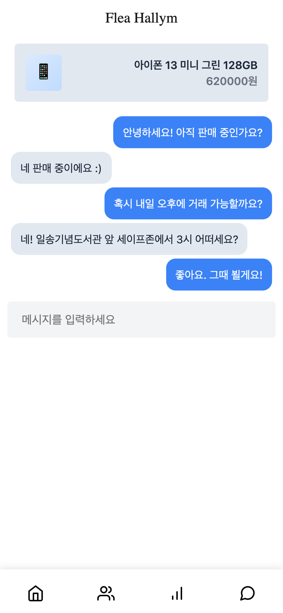
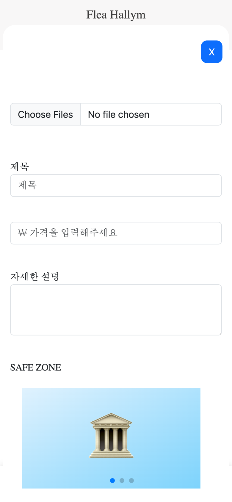
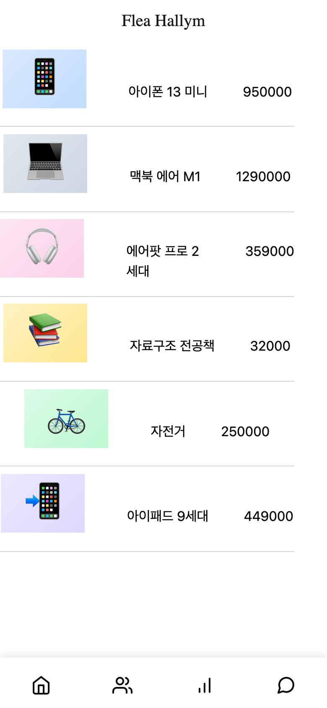
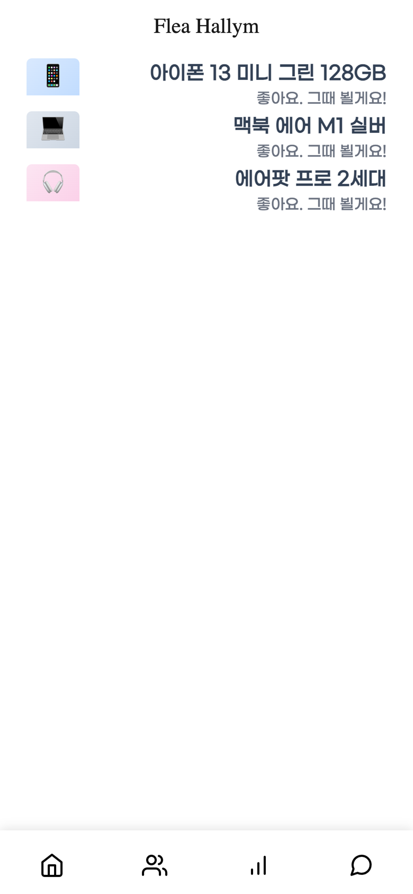

<div align="center">

# 🛍️ Flea Hallym

**한림대 재학생을 위한 안전한 교내 중고거래 웹앱**

CCTV가 있고 사람이 많은 교내 **세이프존**에서만 거래하도록 해서 대면 직거래의 위험을 줄입니다.

🥇 **한림대학교 오픈소스 웹 해커톤 금상**







</div>

<br />

## 🏆 수상


## 🔎 만든 이유


중고거래 앱의 대면 직거래에서 범죄 피해가 늘고 있다는 기사가 계속 나왔습니다. 재학생끼리라도 낯선 사람과 단둘이 만나는 건 불안하기 마련이라, **거래 장소를 안전한 곳으로 정해 두는 교내 전용 중고거래 서비스**를 만들었습니다.

## 📱 화면

| 홈 | 상품 상세 | 글쓰기 |
| :---: | :---: | :---: |
|  |  |  |
| 판매 중인 상품 목록 | 시세 비교 배너 · 세이프존 위치 · 채팅 진입 | 사진·가격 입력, 세이프존 캐러셀 선택 |

| 시세 조회 | 시세 차트 | 채팅 목록 | 채팅 |
| :---: | :---: | :---: | :---: |
|  |  |  |  |
| 품목별 정가 | 최근 10일 평균 시세 | 상품별 대화방 | 판매자와 1:1 대화 |

## 📌 주요 기능

### 🛡️ 세이프존


- 교내에서 **CCTV가 있고, 밝고, 사람이 많은 곳**을 세이프존으로 지정했습니다.
- 상품을 올릴 때 현재 위치 기준으로 가까운 세이프존을 **이미지 캐러셀**에서 고릅니다.
- 상품 상세에서 거래 장소의 이름·설명·사진을 확인할 수 있습니다.

### 💬 채팅


- 상품 상세의 **판매자와 채팅하기**로 바로 대화를 시작합니다.
- 대화는 상품·구매자·판매자 단위로 방이 나뉘어 저장됩니다.
- Sendbird UIKit과 Socket.io로 구현했습니다.

### 📈 시세 조회


- "얼마에 올리지?" 고민을 덜도록 등록된 품목별 **최근 10일 평균 시세**를 차트로 보여 줍니다.
- 상품 상세 상단 배너에서 **평균 시세보다 얼마나 싸거나 비싼지** 바로 알려 줍니다.

## ⚙️ 기술 스택

| 구분 | 사용 기술 |
| --- | --- |
| Front | TypeScript, Next.js 13 (App Router), SWR, Axios, Emotion, styled-components, Tailwind CSS |
| UI · 차트 | React Bootstrap, Swiper, Recharts, ApexCharts |
| 채팅 | Sendbird UIKit, Socket.io |
| 지도 · 위치 | Kakao Maps SDK, Geolocation API |
| Back | Next.js |

## 🗂️ 구조

```
app/
├── page.tsx               # 홈 (상품 목록 + 글쓰기)
├── productdetail/[id]     # 상품 상세 · 세이프존 · 시세 배너
├── priceinquiry/          # 시세 조회 목록
├── priceinquiry/[id]      # 품목별 시세 차트
├── chat/                  # 채팅 목록
├── chatDetail/            # 1:1 채팅
└── helper/                # 도움 요청 게시판 (프로토타입)
components/                # Item, ItemAdd, Chart, ChatBubble, Tabbar …
hooks/fetcher.tsx          # SWR fetcher
types/                     # Item · Chat DTO
```

## 🚀 실행

```bash
npm install
npm run dev   # http://localhost:8050
```

> 해커톤 당시 백엔드 서버는 현재 내려가 있습니다. 위 화면 캡쳐는 실제 프론트 코드를 그대로 띄우고 API 응답만 목 데이터로 대체해 찍었습니다.

## 👥 팀

| 이름 | 역할 |
| --- | --- |
| [안승찬](https://github.com/Ahnseungc) | Front |
| 최세형 | Back |

> 해커톤 원본 레포: [Ahnseungc/Hackton_hallym](https://github.com/Ahnseungc/Hackton_hallym)
